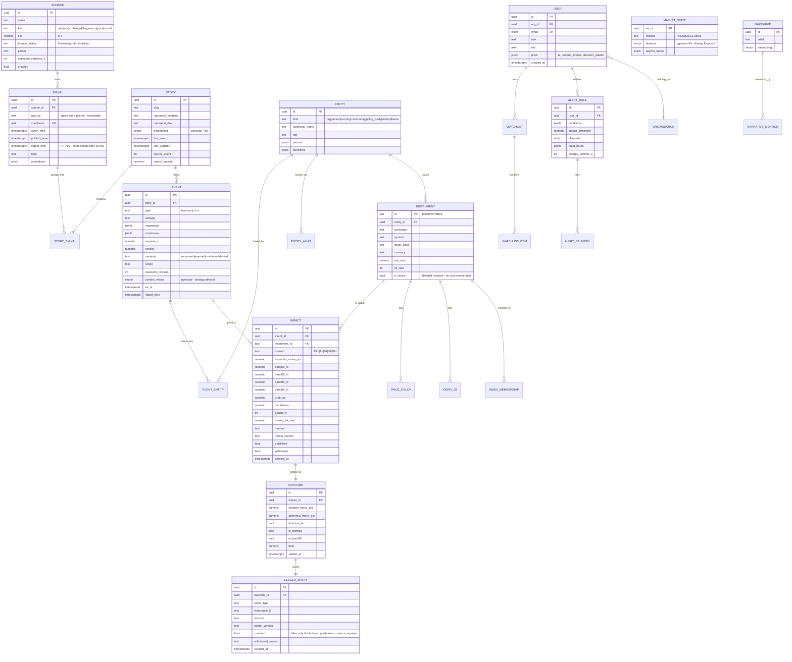

# ER Diagram

**Status:** Draft v1 · **Date:** 2026-11-12
Mermaid source below renders to `er-diagram.png` via
`npx -y @mermaid-js/mermaid-cli -i er-diagram.mmd -o er-diagram.png`.
Field-level detail in [`entities.md`](entities.md).

---

## 1. The spine — how the five core objects connect

```
   ┌──────────┐  n:1  ┌──────────┐
   │  SOURCE  │◀──────│  SIGNAL  │  raw, immutable, append-only
   └──────────┘       └────┬─────┘
                           │ n:1
                           ▼
                     ┌──────────┐  1:n   ┌───────────────┐
                     │  STORY   │───────▶│ STORY_SOURCE  │ (tier, stance)
                     └────┬─────┘        └───────────────┘
                          │ 1:n
                          ▼
                    ┌───────────┐  n:m   ┌─────────────┐
                    │   EVENT   │◀──────▶│   ENTITY    │ org/person/country/theme
                    └─────┬─────┘        └──────┬──────┘
                          │ 1:n                 │ 1:n
                          ▼                     ▼
                    ┌───────────┐         ┌──────────────┐
                    │  IMPACT   │────────▶│  INSTRUMENT  │
                    └─────┬─────┘  n:1    └──────┬───────┘
                          │ 1:1                  │ 1:n
                          ▼                      ▼
                    ┌───────────┐         ┌──────────────────────────────┐
                    │  OUTCOME  │         │ PRICE_OHLCV · DERIV_OI · IV  │
                    └─────┬─────┘         │ FLOWS · FUNDAMENTALS         │
                          │ 1:1           └──────────────────────────────┘
                          ▼
                 ┌────────────────┐
                 │ LEDGER_ENTRY   │  public, append-only, never deleted
                 └────────────────┘
```

## 2. Full mermaid source



## 3. Store placement

| Table group | Store | Why |
|---|---|---|
| `source`, `signal` (metadata), `story`, `event`, `impact`, `outcome`, `ledger_entry`, `entity`, `instrument`, `user`, `watchlist`, `alert_*` | **Postgres 17** | Relational integrity, transactions, the ledger's append-only guarantees |
| `signal.raw` payloads | **R2 object store** | Immutable, cheap, replayable (commitment C1) |
| `story.embedding`, `event.context_vector`, `market_state.features`, `narrative.embedding` | **pgvector (HNSW)** | Co-located with relational data; one fewer system |
| `price_ohlcv`, `price_tick`, `deriv_oi`, `iv_surface`, `flows` | **TimescaleDB hypertables** | Compression + time-bucket queries; → ClickHouse at tick scale ([ADR-005](../04-architecture/adr/005-timeseries-store.md)) |
| search documents | **Typesense** | Full-text + facets |
| hot reads, alias dictionary, dedupe windows | **Redis** | |

## 4. Invariants enforced in the schema itself

| # | Invariant | Mechanism |
|---|---|---|
| S1 | `signal` is append-only | No UPDATE/DELETE grant for any application role; `ingest_time` defaults to `now()` and is immutable |
| S2 | Every published `impact` traces to ≥1 `signal` | FK chain impact→event→story→story_signal→signal, enforced by a trigger on publish |
| S3 | `outcome` and `ledger_entry` have no DELETE path | Revoked at the role level; `withdrawn` is a flag on `impact`, never a deletion |
| S4 | No `action`/`recommendation` column exists anywhere | Compliance boundary (I4). CI schema-diff test asserts it stays absent |
| S5 | Backtests cannot see the future | All training reads go through a PIT view filtered on `ingest_time <= as_of`; direct table access blocked in CI |
| S6 | Delisted instruments are retained | `is_active = false`, never deleted — prevents survivorship bias |
| S7 | Index membership is time-ranged | `index_membership(valid_from, valid_to)` — point-in-time correct |
